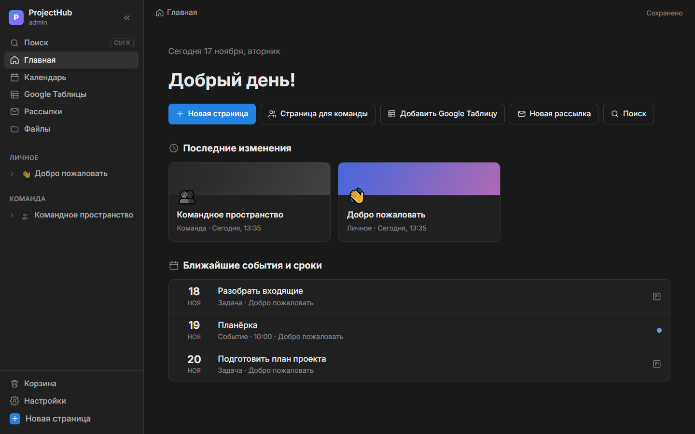
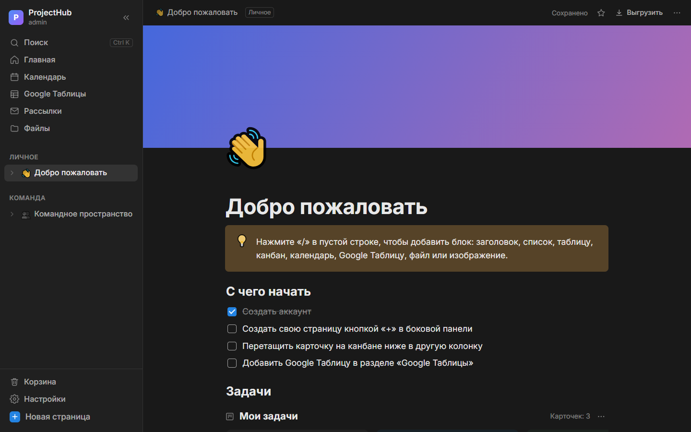
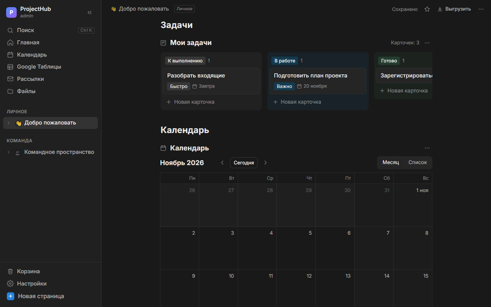
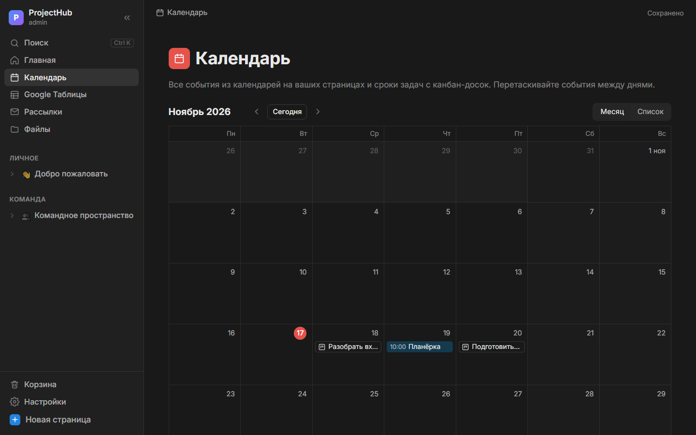

<div align="center">

# 🗂 ProjectHub

**Self-hosted рабочее пространство в стиле Notion: страницы с блоками, канбан-доски, календари, таблицы, Google Таблицы и e-mail-рассылки на своём сервере.**


-informational)




</div>

Личный менеджер проектов, которым я пользуюсь каждый день. Без сборщика, без базы данных и без внешних сервисов:
4 зависимости в `package.json`, данные лежат в JSON-файлах, а разворачивается всё одной командой `node server.js`.

## Возможности

- **Страницы**: вложенные, с иконками и обложками, избранное, корзина, перетаскивание в боковой панели.
- **Блочный редактор**: «/» открывает меню блоков; Markdown на лету (`# `, `- `, `[] `, `> `, ```` ``` ````, `---`);
  панель форматирования по выделению; перетаскивание блоков за «⋮⋮».
- **Блоки**: текст, заголовки, списки, задачи, раскрывающийся блок, цитата, выноска, код, подстраница,
  **таблица** (типы столбцов, сортировка, поиск, CSV), **канбан** (свои колонки, сроки, метки, исполнители),
  **календарь** (месяц/список, перетаскивание событий), Google Таблица/Документ/Презентация/Форма, изображение, файл,
  встраивание (YouTube, Figma, Яндекс Карты…).
- **Общий календарь**: события всех календарей и сроки задач с канбан-досок.
- **Google Таблицы**: библиотека ссылок по папкам, просмотр и редактирование внутри, импорт данных в таблицу ProjectHub.
- **Рассылки**: списки адресов, письмо с форматированием, вставка страницы в письмо или вложением, история и статусы.
- **Экспорт**: страница в Markdown / HTML / JSON / PDF, таблица в CSV, полная резервная копия, импорт `.md` (в т.ч. из Notion).
- **Пользователи**: регистрация (вкл./выкл.), приглашения по почте, роли, восстановление пароля по e-mail.
- **Командная работа**: общий раздел «Команда», изменения других подтягиваются автоматически.
- **Интерфейс**: тёмная и светлая тема, 4 размера, адаптация под телефон, поиск по `Ctrl+K`.

<table>
<tr>
<td></td>
<td></td>
</tr>
<tr>
<td align="center"><sub>Страница с блоками</sub></td>
<td align="center"><sub>Канбан и календарь на странице</sub></td>
</tr>
<tr>
<td colspan="2"></td>
</tr>
<tr>
<td colspan="2" align="center"><sub>Общий календарь: события и сроки задач</sub></td>
</tr>
</table>

## Быстрый старт (локально)

```bash
git clone https://github.com/GorSerGit/projecthub.git
cd projecthub
npm install
ADMIN_PASSWORD='придумайте-пароль' npm start     # Windows PowerShell: $env:ADMIN_PASSWORD='...'; npm start
```

Откройте <http://localhost:3000> и войдите как `admin`. При первом запуске создаются пример страницы, канбан и календарь.

## Установка на сервер (Linux, Node.js 18+)

```bash
# 1. Node.js 20 (Ubuntu/Debian)
curl -fsSL https://deb.nodesource.com/setup_20.x | sudo bash - && sudo apt install -y nodejs

# 2. Код проекта, например в /opt/projecthub
cd /opt/projecthub
npm install --omit=dev

# 3. Первый запуск (пароль нужен, только если ещё нет users.json)
ADMIN_PASSWORD='длинный-пароль' node server.js
```

### Постоянная работа (systemd)

Файл `deploy/projecthub.service` скопируйте в `/etc/systemd/system/`, поправьте пути и пользователя, затем:

```bash
sudo systemctl daemon-reload && sudo systemctl enable --now projecthub
sudo journalctl -u projecthub -f   # логи
```

Альтернатива: `npm i -g pm2 && pm2 start server.js --name projecthub && pm2 save && pm2 startup`.

### Домен и HTTPS

Проще всего через Caddy, он сам получает сертификат: пример в [`deploy/Caddyfile`](deploy/Caddyfile).
Для nginx: [`deploy/nginx.conf`](deploy/nginx.conf) + `certbot --nginx`. После этого в **Настройки → Общие → Адрес сайта** укажите `https://ваш-домен`.

### Почта

**Настройки → Почта (SMTP)** → кнопка «Яндекс» / «Gmail» / «Mail.ru». Логин — адрес ящика, пароль — **пароль приложения**
(создаётся в настройках безопасности почты). Кнопка «Отправить тест» сразу проверит настройки.

## Переменные окружения

| Переменная | По умолчанию | Назначение |
|---|---|---|
| `PORT` | `3000` | порт |
| `HOST` | `0.0.0.0` | адрес (за nginx можно `127.0.0.1`) |
| `DATA_ROOT` | папка проекта | где хранить данные |
| `ADMIN_PASSWORD` | `admin1234` | пароль admin при первом запуске, **обязательно задайте свой** |
| `MAX_UPLOAD_MB` | `100` | максимальный размер файла |
| `JWT_SECRET` | из `.jwt-secret` | ключ сессий (генерируется автоматически) |

## Данные и бэкап

Всё хранится в файлах рядом с сервером (или в `DATA_ROOT`). В git они не попадают (см. `.gitignore`):

| Файл / папка | Что внутри |
|---|---|
| `users.json` | пользователи (пароли — в виде хешей) |
| `settings.json` | настройки, в т.ч. пароль SMTP |
| `.jwt-secret` | ключ подписи сессий |
| `data/<login>.json` | личные страницы |
| `spaces/team.json` | командное пространство |
| `uploads/` | загруженные файлы |
| `mail-log.json` | история рассылок |

```bash
tar czf /backup/projecthub-$(date +%F).tgz -C /opt/projecthub users.json settings.json .jwt-secret data spaces uploads
```

Файлы доступны по неугадываемой ссылке `/files/<id>/…` без входа (как «доступ по ссылке»), поэтому картинки работают в письмах.

## Устройство

```
server.js          # Express API: авторизация (JWT), страницы, файлы, почта, настройки
lib/store.js       # хранилище: личные и командные пространства в JSON
lib/render.js      # экспорт страниц в Markdown / HTML
lib/mail.js        # SMTP через nodemailer
public/            # фронтенд без сборки: core.js, editor.js, views.js, app.js, app.css
deploy/            # systemd, nginx, Caddy
```

## Лицензия

[MIT](LICENSE)
